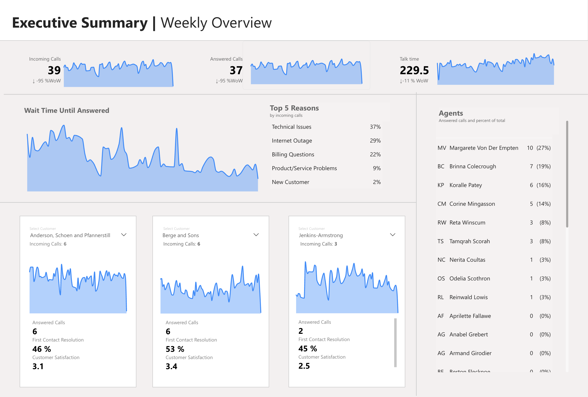

# Contact Center Dashboard Migration and KPI Health

This project is a business analytics case study focused on migrating a contact center dashboard from Tableau to Power BI and extending it with a **KPI Health** page. The migration preserved the core reporting logic, while the new page gave support managers and analysts a way to identify unusual week-over-week changes and decide where to investigate.

My goal was to show the judgment involved in both parts of the work. For the migration, that meant understanding which calculations and interactions the business relied on and choosing the right Power BI equivalents. For the extension, it meant building a repeatable analysis that made unusual changes easy to spot and interpret.

## Project Links

- **Original Tableau dashboard** · [Call Center Agent Analytics by phData on Tableau Exchange](https://exchange.tableau.com/products/662)
- **Power BI report** · [Published Dashboard](https://app.powerbi.com/links/HSQbvuukss?ctid=99f16da4-77a2-4e2f-b4c8-6d86828b58fa&pbi_source=linkShare&bookmarkGuid=2a85bbfb-4a05-4df2-882d-a0ce9a7cbd4b)
- **Tableau dependency analysis** · Add the Python script and field inventory
- **KPI Health analysis** · Add the Python script and weekly KPI export

## Executive Summary

In this case study, a contact center needed to move its existing reporting to Power BI while keeping familiar metrics available to its support team. The analytics team also wanted a better way to review weekly performance. A change in call volume, wait time, first contact resolution, or customer satisfaction was easy to see on a chart. The harder question was whether the change was unusual enough to investigate.

I rebuilt the reporting in Power BI and added a second page dedicated to **KPI Health**. The original reporting helps users monitor performance across selected weeks, customers, and agents. The KPI Health page uses weekly metrics and priority flags to show which changes warrant a closer look. A flag gives the team a starting point for investigation, with the trend available for context.

## Dataset Source and Case Study Scope

I used the sample call-level data packaged with the Tableau Exchange accelerator. It includes call timestamps, customer and agent information, call reasons, abandon flags, wait and talk times, first contact resolution flags, and satisfaction scores. I used the accelerator as the migration reference and built a simulated business scenario around it. [View the source accelerator on Tableau Exchange](https://exchange.tableau.com/products/662)

## Project Workflow

### 1. Decompose the Tableau dashboard

I started with a Python tool I built to map Tableau workbook dependencies. It surfaced calculated fields, their upstream inputs, and where fields were used in the workbook. That let me trace a dashboard metric back to its source columns and see which date filters, parameters, or other calculated fields affected the result.

The dependency inventory gave me a reference for the migration. For example, a satisfaction field could be defined over a rolling 90-day window while its worksheet also applied a chosen-week filter. Both pieces of logic mattered when validating the number shown on the screen.

### 2. Rebuild and validate the report in Power BI

I used **Power Query** for reusable data transformations and **DAX** for measures that needed to respond to report selections. I compared key outputs with the Tableau source using equivalent dates and filters, paying particular attention to how call IDs were counted and how reporting windows were applied. I used native Power BI features where Tableau interactions worked differently.&#x20;

### 3. Build the KPI Health page

I used my Python anomaly detection code to create a **weekly KPI semantic layer** for the second report page. The table brings weekly KPI values, change calculations, and priority flags together so the visuals can use the same definitions for each metric.

The page helps a support manager see **what moved, when it moved, and which changes to look into first**. The analytics team can trace the weekly values and flags back to the Python logic when a change needs further investigation.

## Tools and Technologies

| Tool                 | How I used it                                                                          |
| -------------------- | -------------------------------------------------------------------------------------- |
| **Tableau**          | Inspected the source workbook and validated key outputs during migration               |
| **Python**           | Extracted Tableau dependencies, calculated weekly KPIs, and generated anomaly flags    |
| **Power Query**      | Prepared reusable fields and date transformations for the Power BI model               |
| **Power BI and DAX** | Rebuilt the report, implemented filter-aware measures, and created the KPI Health page |
| **GitHub**           | Organized the code, report assets, and case study documentation                        |

### AI Usage Disclosure

For this project, AI supported documentation and troubleshoot Power BI behavior. I used AI only to accelerate execution while maintaining full responsibility for the logic, conclusions, and final deliverables.
